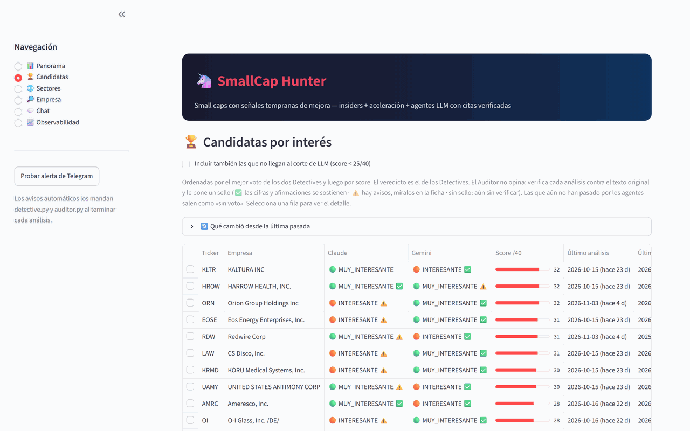
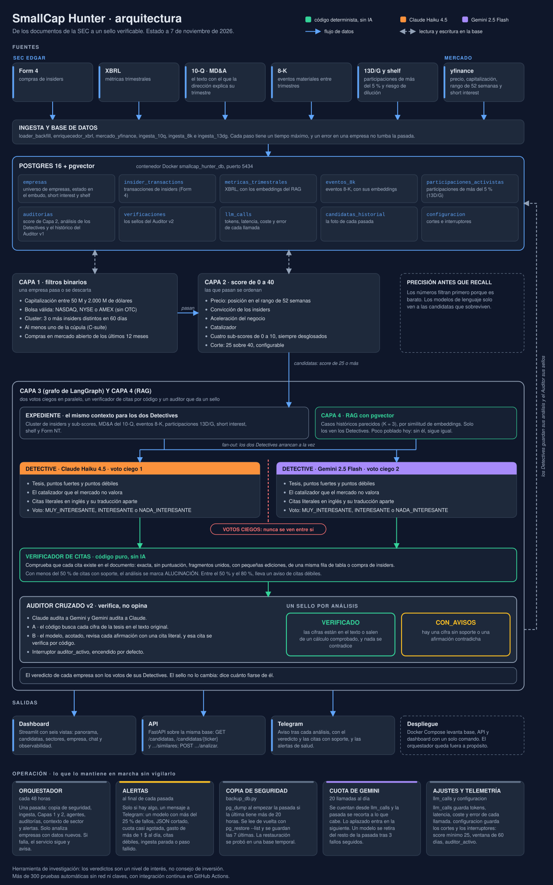
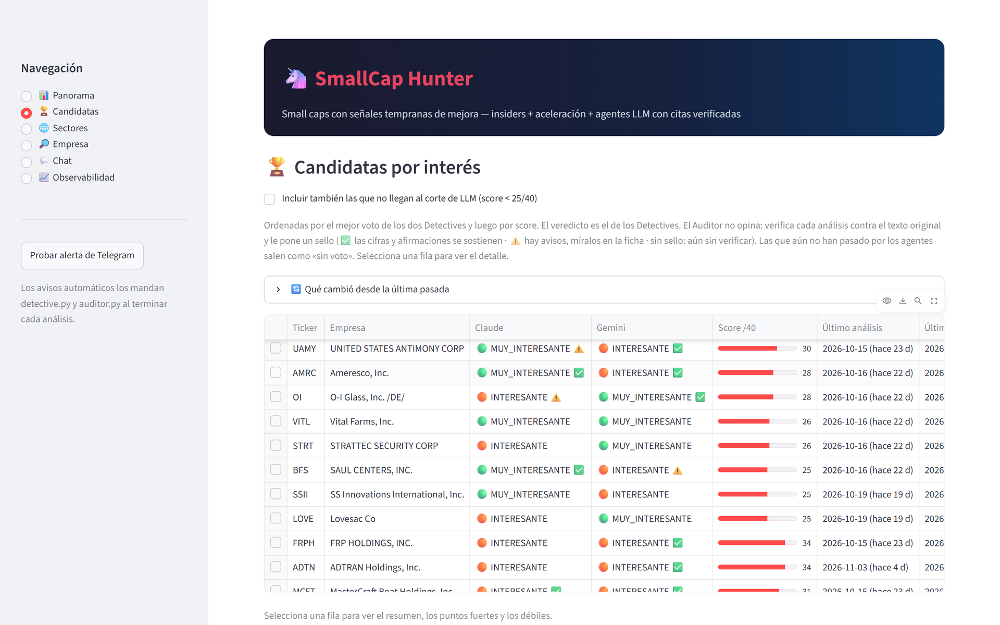
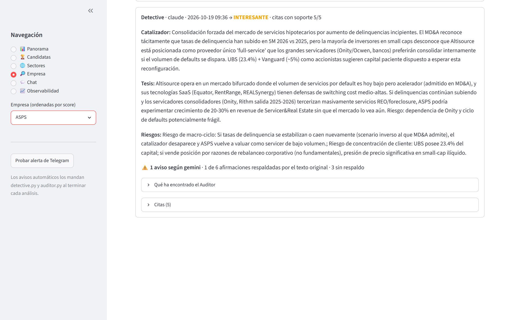
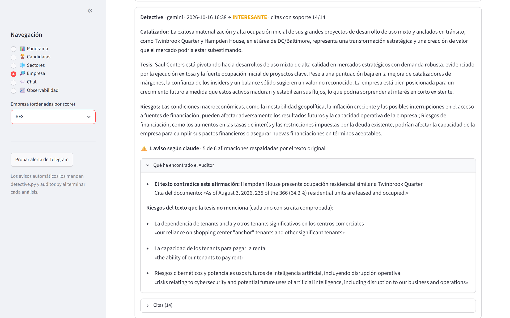
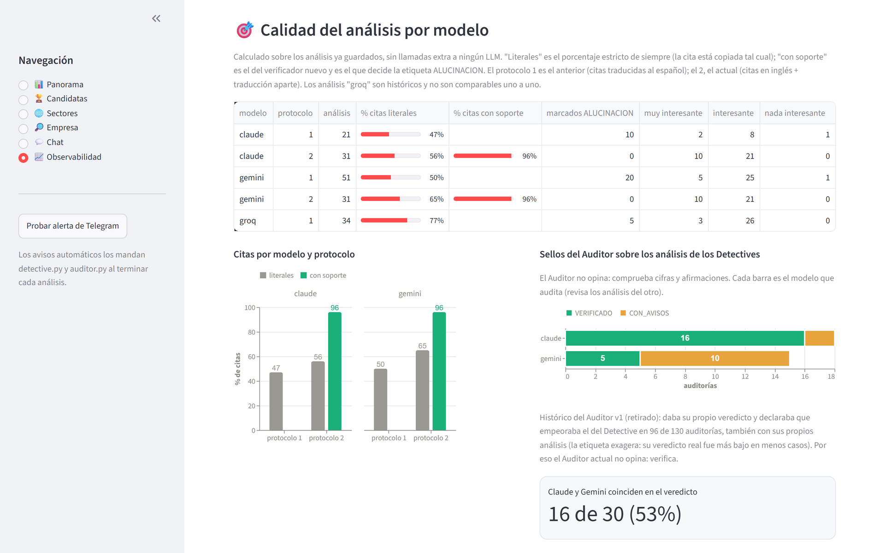

# SmallCap Hunter

[](https://github.com/Guille6520/SmallcapHunter/actions/workflows/tests.yml)

[](LICENSE)

**Criba small caps americanas con datos públicos de la SEC y deja unas pocas candidatas con evidencia citada, verificada por código y con un sello de cuánto fiarse de cada análisis.**



## Qué es y qué no es

Soy inversor y quería una herramienta que hiciera por mí el trabajo pesado y aburrido: leer miles de formularios de insiders, quedarme con las pocas empresas que merece la pena mirar y enseñarme, con citas del documento original, por qué. La construí para usarla yo.

- **Es** una herramienta de investigación. Busca señales tempranas (varios directivos comprando a la vez, crecimiento que se acelera, márgenes que mejoran) en empresas pequeñas, para que luego las investigue yo por mi cuenta.
- **No es** un predictor ni un consejo de inversión. **No hay evidencia de que su selección bata al mercado**; lo que he medido apunta más bien a lo contrario (ver [Lo que sé y lo que no](#lo-que-sé-y-lo-que-no)).
- El «veredicto» (`MUY_INTERESANTE`, `INTERESANTE`, `NADA_INTERESANTE`) es **un nivel de interés para investigar**, no una predicción de que la acción suba. Lo dan dos modelos de lenguaje que no están calibrados y a veces cambian de opinión al re-analizar la misma empresa.

Es mi proyecto final del Bootcamp de IA Fullstack de KeepCoding (2026). Todo el código, los datos y las medidas de este repositorio salen de mi propio sistema.

## Cómo funciona



| Capa | Qué hace | Cómo |
|---|---|---|
| 1. Filtros binarios | Descarta casi todo | Capitalización entre 50 M y 2.000 M de dólares, bolsa válida (NYSE, NASDAQ, AMEX), cluster de compras (3 o más insiders distintos en 60 días, reciente) y al menos un comprador del cluster en la dirección (CEO, CFO...) |
| 2. Score 0–40 | Ordena a las que pasan | Cuatro sub-scores de 0 a 10: precio (posición en el rango de 52 semanas), convicción de los insiders, aceleración del crecimiento (entre trimestres consecutivos, decididos por la fecha de cierre) y catalizador (márgenes y caja). Corte en 25 (configurable) |
| 3. Agentes (LangGraph) | Analiza a las que superan el corte | Dos Detectives, un Auditor y un verificador de citas que es código, no un modelo (ver abajo) |
| 4. RAG (pgvector) | Aporta casos históricos parecidos | Solo lo ve el Detective. Hoy está poco poblado (ver limitaciones) |

Fuentes: Form 4 (compras de insiders), XBRL (métricas trimestrales), 10-Q (MD&A), 8-K (eventos), 13D/G (participaciones de más del 5 %) y yfinance (mercado).

### Qué lo hace distinto

Un solo LLM que opina sobre una empresa es fácil de construir y difícil de creer. Lo que he intentado es que ninguna afirmación dependa de la palabra de un modelo.

- **Dos Detectives ciegos.** Claude Haiku 4.5 y Gemini 2.5 Flash analizan la misma empresa por separado, sin ver el análisis del otro, y votan. El veredicto de una empresa son esos dos votos, nada más. El desacuerdo se ve (en las 30 empresas con análisis de los dos, coinciden en el veredicto en 16, el 53 %) y es información útil.
- **Verificador de citas determinista.** Cada cita de un análisis tiene que aparecer en el documento original. Lo comprueba un programa, sin otro modelo: exacta, sin puntuación, fragmentos unidos, compra de insiders que coincide con el Form 4, casi literal... Las citas traducidas, parafraseadas o inventadas no cuentan como respaldo. Con menos del 50 % de citas con soporte el análisis se marca `ALUCINACION`.
- **Auditor cruzado que verifica en vez de opinar.** Claude audita a Gemini y Gemini a Claude. No da un veredicto: comprueba. Una parte es código (saca cada porcentaje e importe de la tesis y mira si está en el texto original) y otra es el modelo, acotado (revisa afirmación por afirmación con una cita literal que luego verifica el código, y solo puede absolver una cifra si enseña un cálculo cuyos operandos están de verdad en el texto). El modelo propone, el código comprueba.
- **Sellos.** El resultado del Auditor es un sello por análisis: `VERIFICADO` o `CON_AVISOS` (cifras sin soporte, afirmaciones contradichas por el texto o riesgos omitidos con cita real). El sello no cambia el veredicto del Detective: dice cuánto fiarse de él.

Por qué el Auditor es así, y no como empecé, es la parte más instructiva del proyecto: mi primer Auditor daba un veredicto propio, lo medí y era ruido. La historia completa está en [docs/hallazgos.md](docs/hallazgos.md).

## Cifras actuales (7-nov-2026)

Salen de mi base de datos y de la suite de tests; cambian en cada pasada.

| Qué | Cifra |
|---|---|
| Empresas descubiertas | 11.251 (3.342 activas) |
| Transacciones de insiders (Form 4) | 3.573.059; además 723 eventos 8-K y 894 participaciones 13D/G |
| Pasan los filtros de la Capa 1 | 105 |
| Candidatas (score ≥ 25 sobre 40) | 17 (16 de empresas aún activas), tras corregir el score de aceleración (ver [hallazgos](docs/hallazgos.md#12-un-fallo-en-el-score-de-aceleración-encontrado-al-documentar-el-código-7-nov)); eran 27 |
| Empresas con algún análisis de Detective | 55 |
| Análisis con el protocolo 2 actual (incluye reanálisis) | 62 (31 de Claude y 31 de Gemini) |
| Citas con soporte en el documento (protocolo 2) | 96 % de media, en los dos modelos |
| Análisis marcados `ALUCINACION` (protocolo 2) | 0 de 62 |
| Sellos del Auditor v2 hasta ahora | 33 (en 18 empresas): 21 `VERIFICADO` y 12 `CON_AVISOS`. Faltan 13 análisis por verificar (8 empresas candidatas). Con aviso salen 10 de 15 análisis de Claude y 2 de 18 de Gemini |
| Auditorías de la v1 (Auditor antiguo, con veredicto propio) conservadas como histórico | 130 |
| Tests | 330, todos offline |
| Gasto registrado en LLM desde el 29-sep | unos 3,3 $ estimados en 309 llamadas, todas de Claude (1,9 céntimos de media); Gemini va en el tier gratuito |

Los 33 sellos son una primera pasada, no una evaluación: no sé aún qué tasa de falsas alarmas tiene el sello. Un dato que me hace desconfiar de él en vez de fiarme: de los 20 avisos, 14 son afirmaciones que el modelo da por contradichas por el texto (con una cita real) y solo 6 son cifras. Lo primero es justo la parte donde el modelo opina, y el caso de BFS (ver `docs/hallazgos.md`) es dudoso.

## Lo que sé y lo que no

Esta sección es la que más me importa. Un proyecto que solo cuenta lo que le salió bien no sirve para decidir nada.

**1. No he demostrado que la señal bata al mercado.** Lo he intentado medir de varias formas y ninguna lo respalda:

- *Validación histórica* (`descubrir_clusters_historicos.py`, `validacion_historica.py`). Busqué clusters de insiders en todo el histórico de mi base: 4.305 casos. Para saber si la empresa era de verdad una small cap *en ese momento* reconstruí su capitalización de la época (precio histórico por acciones en circulación). Solo pude validar **274** de los 4.305: 218 ya eran de otro tamaño, 415 no tienen precio histórico en Yahoo (deslistadas, sobre todo) y 3.398 no tienen dato de acciones en circulación para esa fecha. Es decir, la muestra es el 6 % de lo que encontré, y está sesgada hacia empresas que siguen cotizando.
- *Backtest de rendimiento frente al Russell 2000 (IWM).* Hice un análisis exploratorio con esos 274 eventos que apuntaba en la misma dirección (exceso de retorno mediano negativo a 12 y 24 meses y la mayoría de los eventos por debajo del índice), pero **no conservo ni el script ni los resultados, así que no publico cifras: no puedo reproducirlas.** `backtest_rendimiento.py` (que sí está) se hizo para esta pregunta, pero solo escribe su resumen en el log y no guarda resultados. Rehacerlo con resultados guardados está en el roadmap.
- *Recall sobre «ganadoras»* (`validacion_recall_ganadoras.py`, resultados en `resultados_test_ganadoras.csv`). De 141 empresas de mi base que multiplicaron por 3 o más desde su mínimo como small cap, 86 (61 %) habían mostrado el cluster antes. Es un número que impresiona y que no prueba nada: no hay grupo de control (cuántas empresas con cluster *no* subieron), las ganadoras se eligen sabiendo el resultado y solo veo las que siguen vivas.
- *Veredictos de los agentes contra el resultado* (`backtest_capa3.py`, resultados en `resultados_ciego_mixtos.csv`). Hice que el Detective analizara en ciego (empresa anonimizada y años enmascarados) 57 casos históricos, con una versión anterior del Detective. Dio 46 `NADA_INTERESANTE`, 10 `INTERESANTE` y 1 `MUY_INTERESANTE`. El exceso mediano a 12 meses fue de -18 % tanto en los `INTERESANTE` como en los `NADA_INTERESANTE`: el veredicto no distinguía. Y en una prueba aparte con 4 empresas que acabaron subiendo mucho (`resultados_ciego_ganadoras.csv`), el agente dio `NADA_INTERESANTE` a las cuatro.

Limitaciones de todo lo anterior: muestras pequeñas, sesgo de supervivencia (lo que deja de cotizar desaparece de los datos de precio, aunque la dirección neta del sesgo no está medida), mercado común para todas las empresas y eventos muy concentrados en 2022–2025 (comparten régimen). No tengo evidencia, ni a favor ni en contra, de que el sistema actual funcione como método de selección. Tampoco tengo evidencia de que lo contrario sea cierto: lo que sé es que los controles que he hecho no encuentran ventaja.

**2. La hipótesis de fondo es una pregunta abierta, y la trato como tal.** La Capa 2 premia estar cerca de mínimos de 52 semanas (tesis V1). En la rama [`tesis-v2`](https://github.com/Guille6520/SmallcapHunter/tree/tesis-v2) hay la tesis contraria (premiar máximos, apoyada en George y Hwang, 2004), **pre-registrada** antes de ver resultados: el hash del commit es su sello de fecha. Son dos tesis distintas, no una mejora medida de la otra. Hoy hay una sola instantánea (26 candidatas en V1, 11 en V2, 4 en las dos; es anterior a la corrección del score de aceleración y habrá que repetirla) y la muestra de cada brazo solo permitiría ver diferencias enormes. El resultado más probable a 12 y 24 meses es «no concluyente». Los resultados por empresa no se publican.

**3. La calidad del análisis sí la he medido, y es lo que funciona mejor.**

| Citas del Detective | Protocolo 1 (antes) | Protocolo 2 (ahora) |
|---|---|---|
| Análisis marcados `ALUCINACION`, Claude | 10 de 21 (48 %) | 0 de 31 |
| Análisis marcados `ALUCINACION`, Gemini | 20 de 51 (39 %) | 0 de 31 |
| Citas copiadas literalmente, Claude / Gemini | 47 % / 50 % | 56 % / 65 % |
| Citas con soporte en el texto, Claude / Gemini | no se medía | 96 % / 96 % |

Cómo leerlo sin venderlo mejor de lo que es: la caída de `ALUCINACION` no es solo que los modelos inventen menos. Cuando volví a puntuar con el verificador nuevo las respuestas del prompt antiguo, sin llamar a ningún modelo, las marcas de Claude bajaron de 6 de 10 a 1 de 10 y las de Gemini se quedaron en 2 de 7. En Claude casi todo el salto es medir mejor; en Gemini, el cambio de prompt. La única cifra comparable sin truco es la de citas literales. Las muestras son pequeñas y no están emparejadas. Y el verificador comprueba que la evidencia **existe**, no que la interpretación sea correcta: una cita real con una explicación inventada pasa. Método y consultas en [docs/evaluacion-citas.md](docs/evaluacion-citas.md).

**4. Lo que no sé del Auditor v2.**

- Hay 33 sellos reales: pocos para evaluar el sello. Falta medir las falsas alarmas a escala: etiquetar a mano las 22 cifras que hoy marca el código y revisar a mano las 14 afirmaciones «contradichas».
- Mi prueba sintética (20 análisis, con una cifra alterada a mano en 10) salió bien: el código detecta 10 de 10, con 1–2 falsas alarmas de 10. Pero es el caso fácil. Sobre los 85 análisis reales más recientes (el último de cada modelo en cada empresa), el comprobador de cifras marca alguna en 18 (21 %), 22 cifras en total, y no por igual: 16 de 32 análisis de Claude (50 %) frente a 2 de 53 de Gemini (4 %), porque Claude escribe muchas más cifras derivadas (sumas, porcentajes de crecimiento). Aún tengo que revisar a mano cuántas de esas 22 son errores y cuántas cálculos legítimos.
- El sello hoy **no mira las afirmaciones sin respaldo ni las citas falsas del propio Auditor**. Con los 33 sellos actuales: de los 21 `VERIFICADO`, 9 tienen alguna afirmación sin respaldo en el texto y 7 alguna afirmación que el Auditor da por «respaldada» con una cita que no se verifica. Es decir, `VERIFICADO` hoy significa «sin cifras dudosas ni contradicciones», no «todo lo que dice el análisis está respaldado». Es una decisión abierta.
- El comprobador de cifras es permisivo. En los textos de tres empresas, entre 77 y 79 de los 96 enteros del 5 al 100 aparecen en el documento, así que un porcentaje inventado suele pasar, y ver una cifra en el texto no prueba que signifique lo mismo. Tampoco hace la aritmética de un cálculo derivado: solo exige que dos operandos estén en el texto.
- Aún no sé si el Auditor v2 reduce errores en la práctica, ni si una cifra o afirmación marcada era un error o una pedantería.

**5. Otras limitaciones.**

- Unas 55 empresas analizadas son una muestra pequeña para sacar conclusiones.
- La cuota gratuita de Gemini (20 llamadas al día) limita a unas 6–10 empresas al día con el Auditor encendido.
- El veredicto no es estable: al re-analizar la misma empresa con el mismo modelo, el veredicto cambió en 27 de 49 re-análisis (el 55 %). Parte puede deberse a datos nuevos o al cambio de protocolo, no solo a ruido del modelo, y no he separado las dos causas.
- Los dos Detectives ven el mismo texto: «ciegos» quiere decir que no ven el análisis del otro, no que sean independientes entre sí.
- El RAG está poco poblado: solo 172 de 67.495 trimestres y 494 de 723 eventos 8-K tienen embedding, y el Auditor no ve el contexto RAG. Sin embeddings el Detective funciona igual, sin ese bloque. Además, la similitud del vecino más cercano es alta para casi todo (mediana 0,87, entre 0,81 y 0,93, medida el 7-nov) y no hay umbral mínimo: siempre se pegan 3 casos. Hoy aporta poco.
- Los veredictos casi no discriminan: en los 62 análisis del protocolo 2 no hay ningún `NADA_INTERESANTE` (42 `INTERESANTE` y 20 `MUY_INTERESANTE`, con la misma distribución en Claude y en Gemini). Sospecho anclaje por el score que ven en el prompt y por el corte de 25, pero no lo he medido.
- El Detective solo ve los primeros 12.000 caracteres del MD&A de cada 10-Q (el texto medio tiene unos 50.000; 317 de 319 lo superan), mientras que el verificador comprueba las citas contra el texto completo: puede dar por buena una cita de un trozo que el modelo no vio.
- La API no tiene autenticación ni límite de uso, y `POST .../analizar` gasta las claves de los modelos: está pensada para local.
- Con Docker Compose la base arranca vacía y el orquestador queda fuera. Además, `backup_db.py` busca por defecto el contenedor `smallcap_hunter_db` (el del arranque manual): con Compose el contenedor se llama distinto (míralo con `docker compose ps`) y hay que ponerlo en `DB_CONTAINER` del `.env`.
- Los precios vienen de yfinance, que no es una fuente oficial.

## Vista personal de seguimiento

Hay una vista opcional, de uso personal y **apagada por defecto**, que no se muestra ni se descarga nada salvo que se active con `MOSTRAR_SEGUIMIENTO=1` en el `.env`. No es un resultado del proyecto, no se documenta aquí con cifras y no es consejo de inversión.

## Arranque rápido con Docker Compose

Levanta Postgres con pgvector, la API y el dashboard con un comando.

```bash
git clone https://github.com/Guille6520/SmallcapHunter.git
cd SmallcapHunter
cp .env.example .env        # rellena al menos DB_PASSWORD
docker compose up -d --build
```

- Dashboard: <http://localhost:8501>. API: <http://localhost:8000/docs>.
- La base se crea **vacía** con `schema.sql` la primera vez. Los datos viven en el volumen `pgdata`.
- Las claves de Anthropic y Gemini solo hacen falta para analizar. Para ver el dashboard y la API no.
- El orquestador (la pasada que descarga datos y llama a los modelos) **no** está en Compose a propósito: lanza sus pasos como subprocesos y hace la copia de seguridad hablando con Docker. Se lanza desde tu máquina (ver abajo), con `DB_HOST=127.0.0.1` y `DB_PORT=5434` en el `.env`.
- Puertos configurables con `DB_PORT`, `API_PORT` y `DASHBOARD_PORT`.

## Arranque manual

Requisitos: Python 3.12, Docker Desktop, una clave de [Anthropic](https://console.anthropic.com) (Claude Haiku 4.5, de pago, céntimos por análisis) y otra gratuita de [Google AI Studio](https://aistudio.google.com) (Gemini).

```bash
pip install -r requirements.txt

docker run -d --name smallcap_hunter_db \
  -e POSTGRES_PASSWORD=tu_password \
  -e POSTGRES_DB=smallcap_hunter \
  -p 5434:5432 \
  pgvector/pgvector:pg16

# Aplicar el esquema
# Linux / Mac
docker exec -i smallcap_hunter_db psql -U postgres -d smallcap_hunter < schema.sql
# Windows PowerShell (la redirección < no funciona)
Get-Content schema.sql | docker exec -i smallcap_hunter_db psql -U postgres -d smallcap_hunter
```

Copia `.env.example` como `.env` y rellénalo. Todos los scripts lo cargan solos (python-dotenv):

```
DB_HOST=127.0.0.1        # en Windows con Docker Desktop, NO usar "localhost"
DB_PORT=5434
DB_NAME=smallcap_hunter
DB_USER=postgres
DB_PASSWORD=tu_password
ANTHROPIC_API_KEY=...
GEMINI_API_KEY=...
SEC_CONTACT_EMAIL=tu_email_real@dominio.com   # la SEC lo exige en el User-Agent
# Opcionales: TELEGRAM_BOT_TOKEN, TELEGRAM_CHAT_ID, BACKUP_DIR, DB_CONTAINER, MOSTRAR_SEGUIMIENTO
```

### Ingesta

```bash
python loader_backfill.py --desde 2015 --hasta 2026   # Form 4 histórico
python enriquecedor_xbrl.py                           # métricas trimestrales XBRL
python mercado_yfinance.py                            # market cap, rango 52 semanas, bolsa
```

### Pipeline de análisis

```bash
python filtro_capa1.py      # Capa 1: filtros binarios
python scorer_capa2.py      # Capa 2: score 0-40
python ingesta_10q.py       # MD&A del 10-Q más reciente de las candidatas
python ingesta_8k.py        # eventos materiales (8-K) de los últimos 12 meses
python ingesta_13dg.py      # participaciones de más del 5 % y shelf registrations

# Opcional, Capa 4 (RAG): embeddings con gemini-embedding-001
python generar_embeddings_rag.py

# Capa 3 de una empresa: los dos Detectives en paralelo y el Auditor cruzado
python grafo_capa3.py --ticker XXXX

# O por separado, para depurar
python detective.py --ticker XXXX --modelo claude    # o gemini
python auditor.py --ticker XXXX                      # audita cruzado y guarda los sellos
```

### Orquestador (modo autónomo)

Encadena todo lo anterior y analiza **solo** las empresas con datos nuevos desde su último análisis.

```bash
python orquestador.py                  # una pasada completa
python orquestador.py --solo-agentes   # salta la ingesta, solo la fase de modelos
python orquestador.py --completo       # incluye XBRL completo y mercado sin límite (lento)
python orquestador.py --daemon         # una pasada cada 48 h
```

Lo que hace por su cuenta: cuenta la cuota gratuita de Gemini que queda hoy y recorta la pasada a lo que cabe; retira un modelo del resto de la pasada tras 3 fallos seguidos, no al primero; reintenta lo que se quedó sin guardar (con tope de 3 fallos por empresa en 7 días); mata un paso que se cuelga (tiempo máximo por paso); descarta un análisis sin veredicto válido en vez de inventar uno; hace una copia de seguridad si la última tiene más de 20 h; guarda una foto de las candidatas para ver qué cambió entre pasadas; y manda alertas por Telegram (opcional) si algo se degrada. El Auditor está **encendido por defecto**; se apaga con la clave `auditor_activo` de la tabla `configuracion` (ver `interruptores.py`) sin borrar nada.

### Dashboard y API

```bash
streamlit run dashboard.py
uvicorn api:app --reload --port 8000     # Swagger en http://127.0.0.1:8000/docs
```









Vistas del dashboard: **Panorama** (embudo, últimos veredictos y qué cambió desde la última pasada), **Candidatas** (ranking con el voto de cada Detective y su sello), **Sectores** (contexto de ETF y titulares, que los agentes no ven y no entra en el score), **Empresa** (ficha con scores, insiders, MD&A, historial de análisis y citas con su verificación), **Chat** (un modelo con el mismo contexto que el Detective) y **Observabilidad**.

Endpoints de la API: `GET /health`, `GET /candidatas`, `GET /candidatas/{ticker}`, `GET /candidatas/{ticker}/similares` (RAG) y `POST /candidatas/{ticker}/analizar` (dispara la Capa 3 y bloquea 1–2 min).

### Copia de seguridad

```bash
python backup_db.py            # pg_dump + comprobación con pg_restore --list, conserva las últimas 7
python backup_db.py --listar
```

Una copia que no se puede leer se borra y se avisa. Probé la restauración en una base temporal con los mismos recuentos que la de producción. Apunta `BACKUP_DIR` a otro disco o a la nube si quieres que sobreviva a un fallo del equipo.

## Observabilidad y alertas

Cada llamada a un modelo (Detective, Auditor, chat y resumen de negocio) se registra en `llm_calls` con tokens reales, latencia, coste estimado y el tipo de error si lo hubo. De ahí sale la pestaña Observabilidad: coste por modelo y por empresa, latencia, cuota de Gemini, errores por tipo (cuota, proveedor saturado, timeout, JSON roto o cortado por `max_tokens`) y calidad de citas por modelo y protocolo. Gracias a ese registro vi que Claude cortaba el JSON justo en el tope de tokens, no por fallo del modelo.

`alertas.py` revisa la salud del sistema al final de cada pasada y, solo si hay algo, avisa por Telegram: modelo con más del 25 % de llamadas fallidas, respuestas truncadas, cuota de Gemini casi agotada, gasto diario por encima de 1 $, calidad de citas baja, paso fallido o SEC sin contacto configurado, y **ingesta parada** (más de 130 días sin Form 4 nuevos, 7 sin mercado, 21 sin 8-K, 45 sin 13D/G o 140 sin 10-Q). Esto último porque mis scripts de ingesta se tragan los errores por empresa y terminan con código 0 aunque no traigan nada.

## Estructura del proyecto

```
├── schema.sql  requirements.txt  pytest.ini  Dockerfile  docker-compose.yml  .env.example  LICENSE
├── normalizar.py                  # reglas únicas de limpieza de datos
│
│   # Ingesta
├── loader_backfill.py             # Form 4 (ZIPs trimestrales de la SEC)
├── enriquecedor_xbrl.py           # métricas trimestrales (companyfacts + SIC)
├── mercado_yfinance.py            # market cap, precio, rango 52 semanas, bolsa
├── ingesta_10q.py                 # MD&A del 10-Q
├── ingesta_8k.py                  # eventos materiales 8-K
├── ingesta_13dg.py                # participaciones de más del 5 % y shelf
├── contexto_sector.py  sectores.py  # ETF de sector y titulares (contexto, no análisis)
│
│   # Pipeline
├── filtro_capa1.py                # 4 filtros binarios
├── scorer_capa2.py                # 4 sub-scores (0-40)
├── detective.py                   # Detective: tesis + citas + RAG
├── verificador_citas.py           # verificador determinista de citas (protocolo 2)
├── auditor.py                     # Auditor: verifica cifras y afirmaciones, da sello
├── verificacion_cifras.py         # la parte de código del Auditor
├── verificaciones.py              # sellos y su tabla propia
├── votos.py                       # qué veredicto enseña el dashboard (el de los Detectives)
├── grafo_capa3.py                 # Detectives + Auditor como grafo de LangGraph
├── embeddings.py  generar_embeddings_rag.py   # Capa 4 (RAG)
│
│   # Operación
├── orquestador.py                 # pasada completa o daemon cada 48 h
├── interruptores.py               # claves de configuración (Auditor encendido/apagado)
├── cuota_gemini.py                # cuota gratuita diaria de Gemini
├── cambios.py                     # qué cambió entre pasadas
├── backup_db.py                   # copia de seguridad verificada
├── alertas.py  notificador_telegram.py  errores_llm.py
├── seguimiento_senales.py         # vista personal opcional (apagada por defecto)
│
│   # Interfaces
├── dashboard.py                   # Streamlit
├── api.py                         # FastAPI
│
│   # Validación (solo lectura, no son tests unitarios)
├── descubrir_clusters_historicos.py  validacion_historica.py  ingesta_10q_historico.py
├── backtest_rendimiento.py  backtest_capa3.py  validacion_recall_ganadoras.py
├── enriquecer_historico_casos.py
├── experimento_auditor.py         # separó el sesgo del Auditor v1 de la calidad de cada Detective
├── validadas_historicas.csv  resultados_*.csv
│
├── docs/                          # architecture.svg, demo.gif, capturas/, hallazgos.md, evaluacion-citas.md
└── tests/                         # 330 tests offline (ver abajo)
```

## Tests y CI

```bash
pip install -r requirements.txt
pytest
```

330 tests, **todos offline**: sin base de datos, sin claves, sin red. Cubren la lógica pura (normalización, filtros, score), el verificador de citas, el comprobador de cifras y los sellos, las reglas de votos e interruptores, los cambios entre pasadas, la copia de seguridad, las alertas, la cuota de Gemini, la política de retirada de modelos del orquestador, el grafo de LangGraph, el RAG y su degradación, y los endpoints de la API. GitHub Actions los ejecuta en cada push (`.github/workflows/tests.yml`, Python 3.12).

Qué cubren de verdad (cobertura de líneas medida con `pytest-cov`, 56 % del total): el núcleo está muy cubierto (verificador de citas 98 %, sellos y votos 100 %, API 94 %, orquestador 87 %, Auditor 80 %); las ingestas, poco (entre el 21 y el 31 %); el dashboard, casi nada (12 %: lo probé a mano y con una prueba de humo); y los scripts de validación histórica, nada, porque no son parte del pipeline. Más tests no es mejor por sí mismo: revisé la suite y no encontré redundancia (solo un par de tests con cuerpos casi iguales, y prueban escenarios distintos). Lo que falta es probar las ingestas contra respuestas de la SEC guardadas.

Los scripts de validación histórica no están en `tests/` a propósito: tardan 30–60 minutos, necesitan red y Postgres, y miden otra cosa (si la hipótesis se sostiene), no si el código hace lo que dice.

## Roadmap realista

En el orden en que lo haría:

0. **Revisar el diseño del propio score con la literatura**: los pesos, qué señales cuentan y cómo se mide la aceleración se decidieron sin contrastarlos. Es lo siguiente, y puede cambiar qué empresas son candidatas.
1. **Medir las falsas alarmas del Auditor a escala**: etiquetar a mano las 22 cifras que hoy marca el código.
2. **Verificar los 13 análisis que quedan pendientes** y decidir si muchas afirmaciones sin respaldo deben dar aviso.
3. **Medir la inestabilidad del veredicto** con datos fijos: re-analizar la misma empresa varias veces y contar cuánto cambia.
4. **Probar un modelo mayor como Detective** (Sonnet) en unas decenas de empresas, para ver si la calidad compensa el coste.
5. **Resolver las deslistadas** en los backtests (una fuente de datos que conserve las empresas que dejan de cotizar) y guardar los resultados en el repo con su script.
6. **Filtro de compra cosmética**: los datos ya están (Item 3.02 del 8-K, shelf del 13D/G) y llegan a los agentes como contexto; falta convertirlos en filtro duro de la Capa 1.
7. **Migraciones del esquema** (hoy `schema.sql` solo crea la base desde cero y las tablas posteriores las crean los propios scripts).
8. **Demo pública de solo lectura** con datos congelados y sin claves.
9. **Ratio de convicción real** (importe frente a compensación anual del insider, desde el DEF 14A) y **track record del insider**.

Dejo fuera a propósito un ranker de machine learning: con 55 análisis y sin evidencia de ventaja, entrenar pesos sería ajustar ruido.

## Licencia

MIT, ver [LICENSE](LICENSE).

> Proyecto de portafolio sobre datos públicos de la SEC, no un producto financiero. Ningún modelo de lenguaje debería decidir dónde pones tu dinero.
