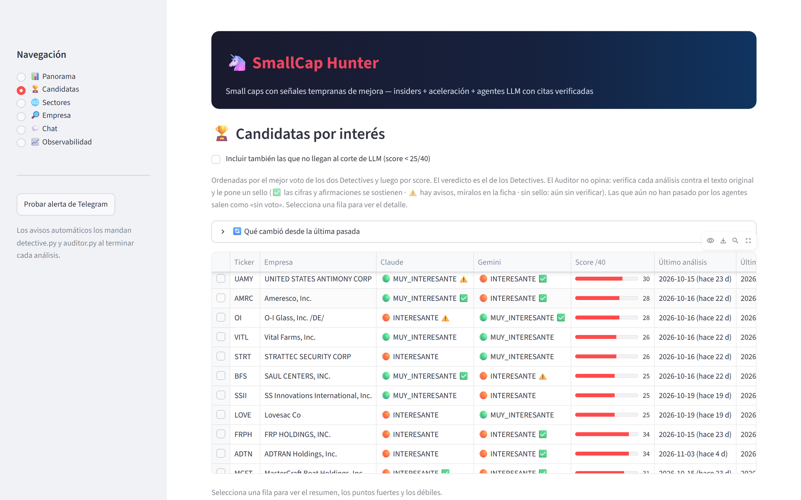
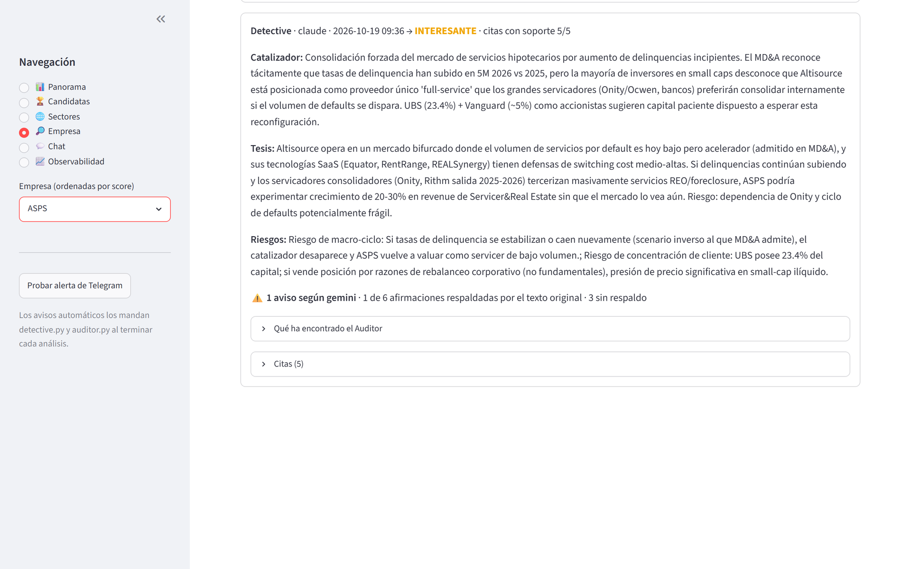
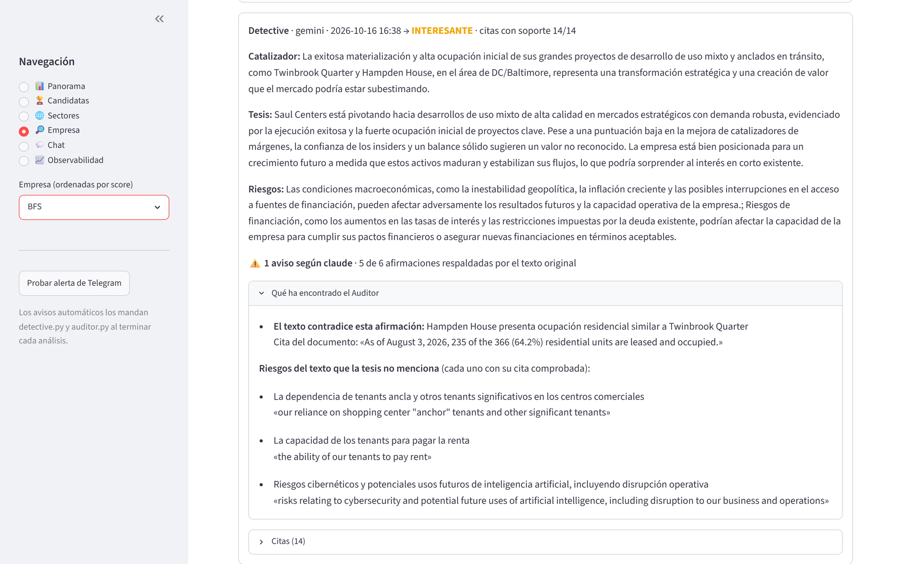
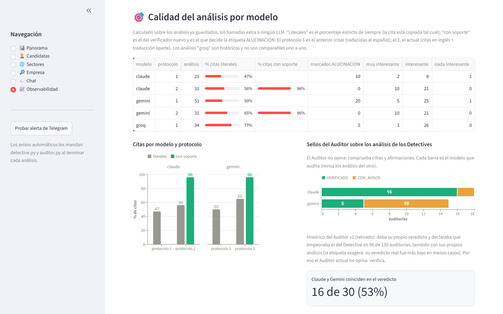

# Cómo arrancarlo y cómo está organizado

## Arranque rápido con Docker Compose

Levanta Postgres con pgvector, la API y el dashboard con un comando.

```bash
git clone https://github.com/Guille6520/SmallcapHunter.git
cd SmallcapHunter
cp .env.example .env        # rellena al menos DB_PASSWORD
docker compose up -d --build
```

- Dashboard: <http://localhost:8501>. API: <http://localhost:8000/docs>.
- La base se crea **vacía** con `schema.sql` la primera vez. Los datos viven en el volumen `pgdata`.
- Las claves de Anthropic y Gemini solo hacen falta para analizar. Para ver el dashboard y la API no.
- El orquestador (la pasada que descarga datos y llama a los modelos) **no** está en Compose a propósito: lanza sus pasos como subprocesos y hace la copia de seguridad hablando con Docker. Se lanza desde tu máquina (ver abajo), con `DB_HOST=127.0.0.1` y `DB_PORT=5434` en el `.env`.
- Puertos configurables con `DB_PORT`, `API_PORT` y `DASHBOARD_PORT`.

## Arranque manual

Requisitos: Python 3.12, Docker Desktop, una clave de [Anthropic](https://console.anthropic.com) (Claude Haiku 4.5, de pago, céntimos por análisis) y otra gratuita de [Google AI Studio](https://aistudio.google.com) (Gemini).

```bash
pip install -r requirements.txt

docker run -d --name smallcap_hunter_db \
  -e POSTGRES_PASSWORD=tu_password \
  -e POSTGRES_DB=smallcap_hunter \
  -p 5434:5432 \
  pgvector/pgvector:pg16

# Aplicar el esquema
# Linux / Mac
docker exec -i smallcap_hunter_db psql -U postgres -d smallcap_hunter < schema.sql
# Windows PowerShell (la redirección < no funciona)
Get-Content schema.sql | docker exec -i smallcap_hunter_db psql -U postgres -d smallcap_hunter
```

Copia `.env.example` como `.env` y rellénalo. Todos los scripts lo cargan solos (python-dotenv):

```
DB_HOST=127.0.0.1        # en Windows con Docker Desktop, NO usar "localhost"
DB_PORT=5434
DB_NAME=smallcap_hunter
DB_USER=postgres
DB_PASSWORD=tu_password
ANTHROPIC_API_KEY=...
GEMINI_API_KEY=...
SEC_CONTACT_EMAIL=tu_email_real@dominio.com   # la SEC lo exige en el User-Agent
# Opcionales: TELEGRAM_BOT_TOKEN, TELEGRAM_CHAT_ID, BACKUP_DIR, DB_CONTAINER, MOSTRAR_SEGUIMIENTO
```

### Ingesta

```bash
python loader_backfill.py --desde 2015 --hasta 2026   # Form 4 histórico
python enriquecedor_xbrl.py                           # métricas trimestrales XBRL
python mercado_yfinance.py                            # market cap, rango 52 semanas, bolsa
```

### Pipeline de análisis

```bash
python filtro_capa1.py      # Capa 1: filtros binarios
python scorer_capa2.py      # Capa 2: score 0-40
python ingesta_10q.py       # MD&A del 10-Q más reciente de las candidatas
python ingesta_8k.py        # eventos materiales (8-K) de los últimos 12 meses
python ingesta_13dg.py      # participaciones de más del 5 % y shelf registrations

# Opcional, Capa 4 (RAG): embeddings con gemini-embedding-001
python generar_embeddings_rag.py

# Capa 3 de una empresa: los dos Detectives en paralelo y el Auditor cruzado
python grafo_capa3.py --ticker XXXX

# O por separado, para depurar
python detective.py --ticker XXXX --modelo claude    # o gemini
python auditor.py --ticker XXXX                      # audita cruzado y guarda los sellos
```

### Orquestador (modo autónomo)

Encadena todo lo anterior y analiza **solo** las empresas con datos nuevos desde su último análisis.

```bash
python orquestador.py                  # una pasada completa
python orquestador.py --solo-agentes   # salta la ingesta, solo la fase de modelos
python orquestador.py --completo       # incluye XBRL completo y mercado sin límite (lento)
python orquestador.py --daemon         # una pasada cada 48 h
```

Lo que hace por su cuenta: cuenta la cuota gratuita de Gemini que queda hoy y recorta la pasada a lo que cabe; retira un modelo del resto de la pasada tras 3 fallos seguidos, no al primero; reintenta lo que se quedó sin guardar (con tope de 3 fallos por empresa en 7 días); mata un paso que se cuelga (tiempo máximo por paso); descarta un análisis sin veredicto válido en vez de inventar uno; hace una copia de seguridad si la última tiene más de 20 h; guarda una foto de las candidatas para ver qué cambió entre pasadas; y manda alertas por Telegram (opcional) si algo se degrada. El Auditor está **encendido por defecto**; se apaga con la clave `auditor_activo` de la tabla `configuracion` (ver `interruptores.py`) sin borrar nada.

### Dashboard y API

```bash
streamlit run dashboard.py
uvicorn api:app --reload --port 8000     # Swagger en http://127.0.0.1:8000/docs
```









Vistas del dashboard: **Panorama** (embudo, últimos veredictos y qué cambió desde la última pasada), **Candidatas** (ranking con el voto de cada Detective y su sello), **Sectores** (contexto de ETF y titulares, que los agentes no ven y no entra en el score), **Empresa** (ficha con scores, insiders, MD&A, historial de análisis y citas con su verificación), **Chat** (un modelo con el mismo contexto que el Detective) y **Observabilidad**.

Endpoints de la API: `GET /health`, `GET /candidatas`, `GET /candidatas/{ticker}`, `GET /candidatas/{ticker}/similares` (RAG) y `POST /candidatas/{ticker}/analizar` (dispara la Capa 3 y bloquea 1–2 min).

### Copia de seguridad

```bash
python backup_db.py            # pg_dump + comprobación con pg_restore --list, conserva las últimas 7
python backup_db.py --listar
```

Una copia que no se puede leer se borra y se avisa. Probé la restauración en una base temporal con los mismos recuentos que la de producción. Apunta `BACKUP_DIR` a otro disco o a la nube si quieres que sobreviva a un fallo del equipo.

## Vista personal de seguimiento

Hay una vista opcional, de uso personal y **apagada por defecto**, que no se muestra ni se descarga nada salvo que se active con `MOSTRAR_SEGUIMIENTO=1` en el `.env`. No es un resultado del proyecto, no se documenta aquí con cifras y no es consejo de inversión.

## Estructura del proyecto

```
├── schema.sql  requirements.txt  pytest.ini  Dockerfile  docker-compose.yml  .env.example  LICENSE
├── normalizar.py                  # reglas únicas de limpieza de datos
│
│   # Ingesta
├── loader_backfill.py             # Form 4 (ZIPs trimestrales de la SEC)
├── enriquecedor_xbrl.py           # métricas trimestrales (companyfacts + SIC)
├── mercado_yfinance.py            # market cap, precio, rango 52 semanas, bolsa
├── ingesta_10q.py                 # MD&A del 10-Q
├── ingesta_8k.py                  # eventos materiales 8-K
├── ingesta_13dg.py                # participaciones de más del 5 % y shelf
├── contexto_sector.py  sectores.py  # ETF de sector y titulares (contexto, no análisis)
│
│   # Pipeline
├── filtro_capa1.py                # 4 filtros binarios
├── scorer_capa2.py                # 4 sub-scores (0-40)
├── detective.py                   # Detective: tesis + citas + RAG
├── verificador_citas.py           # verificador determinista de citas (protocolo 2)
├── auditor.py                     # Auditor: verifica cifras y afirmaciones, da sello
├── verificacion_cifras.py         # la parte de código del Auditor
├── verificaciones.py              # sellos y su tabla propia
├── votos.py                       # qué veredicto enseña el dashboard (el de los Detectives)
├── grafo_capa3.py                 # Detectives + Auditor como grafo de LangGraph
├── embeddings.py  generar_embeddings_rag.py   # Capa 4 (RAG)
│
│   # Operación
├── orquestador.py                 # pasada completa o daemon cada 48 h
├── interruptores.py               # claves de configuración (Auditor encendido/apagado)
├── cuota_gemini.py                # cuota gratuita diaria de Gemini
├── cambios.py                     # qué cambió entre pasadas
├── backup_db.py                   # copia de seguridad verificada
├── alertas.py  notificador_telegram.py  errores_llm.py
├── seguimiento_senales.py         # vista personal opcional (apagada por defecto)
│
│   # Interfaces
├── dashboard.py                   # Streamlit
├── api.py                         # FastAPI
│
│   # Validación (solo lectura, no son tests unitarios)
├── descubrir_clusters_historicos.py  validacion_historica.py  ingesta_10q_historico.py
├── backtest_rendimiento.py  backtest_capa3.py  validacion_recall_ganadoras.py
├── enriquecer_historico_casos.py
├── experimento_auditor.py         # separó el sesgo del Auditor v1 de la calidad de cada Detective
├── validadas_historicas.csv  resultados_*.csv
│
├── docs/                          # architecture.svg, demo.gif, capturas/, hallazgos.md, evaluacion-citas.md
└── tests/                         # 330 tests offline (ver abajo)
```
